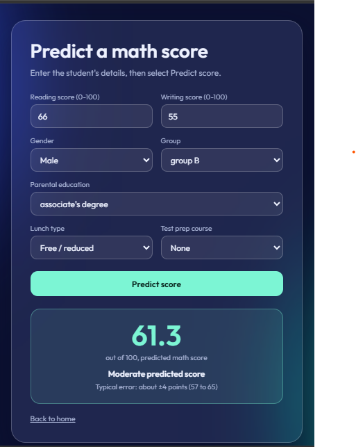

# Student Exam Performance Predictor

An end-to-end machine learning web app that predicts a student's **math exam score** from reading and writing scores, study habits and background. A static glassmorphism frontend talks to a Flask REST API that serves a trained scikit-learn model, and everything ships in one Docker container.



## Highlights

- **Decoupled architecture:** vanilla HTML/CSS/JS frontend calling a JSON REST API with `fetch()`.
- **Modular ML pipeline:** separate ingestion, transformation and training components, plus a reusable prediction pipeline.
- **Model selection:** five regressors compared on a held-out set; the best one is saved automatically.
- **Validated API:** clear 400 / 422 / 503 responses instead of server crashes.
- **Tested and containerised:** 9 pytest tests, Dockerfile and docker-compose (in `docker/`) and a one-file Render deployment.

## Architecture

```
Browser (HTML / CSS / vanilla JS)
        |  fetch() POST /api/predict  (JSON)
        v
Flask app (backend/app.py)  -- serves frontend/ files + /api routes
        |
        v
PredictPipeline (ml_pipeline/pipelines/predict_pipeline.py)
        |  loads artifacts/preprocessor.pkl + artifacts/model.pkl
        v
JSON response: {"predicted_math_score": 61.3}
```

```
student_performance_app/
├── artifacts/        # model.pkl, preprocessor.pkl (generated by training)
├── backend/          # Flask app + API routes
├── data/             # stud.csv
├── docs/             # screenshot
├── frontend/         # index.html, predict.html, css/, js/
├── ml_pipeline/
│   ├── components/   # data ingestion, transformation, model trainer
│   └── pipelines/    # train_pipeline.py, predict_pipeline.py
├── tests/            # pytest API tests
├── docker/           # Dockerfile + docker-compose.yml
├── render.yaml       # Render deployment blueprint
└── requirements.txt
```

## How the model works

- **Data:** 1,000 student records (`data/stud.csv`). **Target:** `math_score`. **Features:** reading score, writing score, gender, group, parental education, lunch type, test prep course.
- **Preprocessing:** median imputation and standard scaling for numeric columns; most-frequent imputation and one-hot encoding for categorical columns. The preprocessor is fit on the training split only, to avoid data leakage.
- **Training:** five models are trained on an 80/20 split and compared on the test set. The one with the highest R² is saved.
- **Inference:** the API validates the payload, applies the saved preprocessor, predicts, and clamps the result to 0-100.

### Model comparison

| Model | R² | MAE (points) |
|---|---|---|
| **Ridge (selected)** | **0.881** | **4.21** |
| CatBoost | 0.872 | 4.29 |
| Gradient Boosting | 0.872 | 4.30 |
| XGBoost | 0.867 | 4.34 |
| Random Forest | 0.854 | 4.63 |

Ridge regression won against the tree ensembles. Math scores depend almost linearly on reading and writing scores, and with only 1,000 rows the more flexible models have little extra signal to learn, so the simplest model generalises best. The UI shows a typical error of about ±4 points, matching the test MAE.

### What drives the prediction

Largest Ridge coefficients (features are standardised, so values show points of math score per unit change):

| Feature | Effect |
|---|---|
| Writing score | +10.7 per standard deviation |
| Gender (male vs female) | +13.0 between the two groups |
| Group E (vs others) | +4.1 |
| Reading score | +3.6 per standard deviation |
| Standard lunch | +1.8 |

Writing and reading scores carry most of the signal, but the model also picks up gender and group effects present in the data. See Limitations.

## API

`POST /api/predict`

```json
{
  "reading_score": 72, "writing_score": 74,
  "gender": "female", "race_ethnicity": "group C",
  "parental_level_of_education": "some college",
  "lunch": "standard", "test_preparation_course": "none"
}
```

| Status | Meaning |
|---|---|
| 200 | `{"predicted_math_score": 70.2}` |
| 400 | Body is not JSON |
| 422 | Invalid values; response includes a `details` list |
| 503 | Model files missing; run the training pipeline |

`GET /api/health` returns `{"status": "ok"}`.

## Run locally

### With Docker
```bash
docker compose -f docker/docker-compose.yml up --build
```
Run this from the project root. Open http://localhost:8000. Trained model files are included in `artifacts/`.

### Without Docker
```bash
python -m venv .venv
.venv\Scripts\activate            # Windows  (Mac/Linux: source .venv/bin/activate)
pip install -r requirements.txt
python -m backend.app
```

### Retrain the model
```bash
python -m ml_pipeline.pipelines.train_pipeline
```

## Tests

```bash
pip install -r requirements-dev.txt
python -m pytest -q
```
The suite covers valid predictions, input validation, error responses (400 / 422 / 503) and static page serving.

## Deploy to Render (free)

1. Push this project to GitHub (keep `artifacts/*.pkl` committed so the container can predict).
2. In Render choose **New → Blueprint** and select the repository. `render.yaml` points to `docker/Dockerfile` and configures a Docker web service with a health check at `/api/health`.
3. Deploy. Render sets the `PORT` variable and the Dockerfile uses it automatically.

On the free plan the service sleeps after inactivity, so the first request can take around 30-60 seconds.

## Limitations

- The dataset is small and appears synthetic, so predictions are illustrative and should not drive real decisions about students.
- Gender and group influence the output because they correlate with scores in the data. A production system would audit these attributes for bias and likely remove them.
- Scikit-learn pickles are version-sensitive; retrain if you change the pinned versions in `requirements.txt`.
